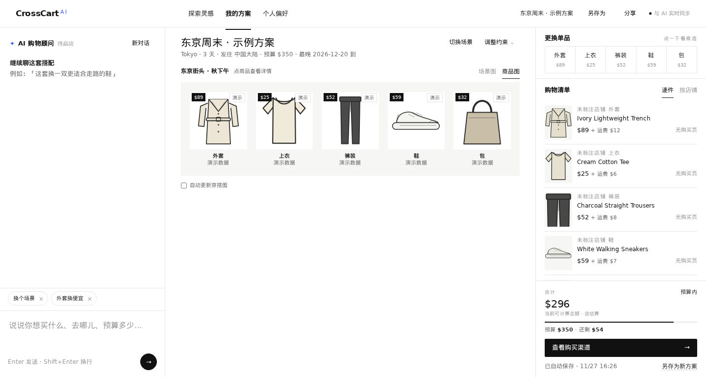
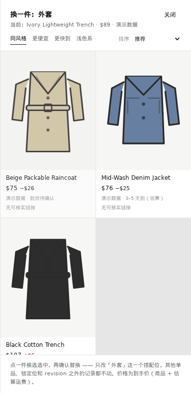
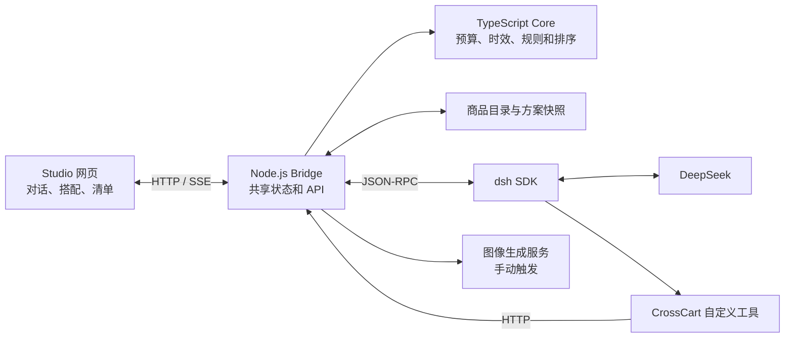

# CrossCart AI

**把一句出行需求变成可修改、可核算的穿搭购物清单。**

CrossCart AI 是一个面向跨境出行的 AI 产品原型。用户说出目的地、预算、收货截止日和已有单品，系统推荐商品、生成方案，并把预计支出、到货风险和购买入口放在同一页面。改一件衣服时，只更新对应搭配位并重新计算。

[线上演示（需要登录）](https://yuncoding.top/) · [产品功能](#产品功能) · [技术架构](#技术架构) · [本地运行](#本地运行)

## 产品截图



桌面工作台将对话、穿搭和购物清单联动。右栏显示可计算费用和预算差额。



手机上可按品类查看候选，并在确认后更换。截图取自隔离的示例环境，商品插图和价格用于展示交互。

## 产品功能

| 功能 | 用户能做什么 |
| --- | --- |
| 自然语言建方案 | 描述场景、预算和自己的衣物，生成包含外套、上衣、裤装、鞋、包的结构化方案 |
| 实物和购买入口 | 查看商家商品图和详情页。正式演示从商家目录中选择带可核实链接的商品 |
| 单件换装 | 按相似风格、更低费用或更快到货找替代品。换件后重新计算预算与到货判断 |
| 费用与风险 | 区分挂牌价、估算运费和待确认费用，比较预计到货时间与用户截止日 |
| 用户偏好 | 使用已确认的长期与本次偏好，支持锁定单品、保留自有衣物 |
| AI 场景图 | 先查看商品组合，按需生成场景效果图。实际规格与购买条件由商家确认 |

### 一个使用例子

> 「去东京玩三天，预算 430 美元，衣服寄到中国大陆，12 月 6 日前收到。我已经有一双白色运动鞋。」

系统保留已有的鞋，查询其余品类，把商品和费用放进方案。用户说「外套换便宜一点，其他别动」时，后端校验只修改外套，再重算整套的费用和到货风险。

## 技术架构



| 层 | 职责 |
| --- | --- |
| [Studio](crosscart/studio/) | 网页以 HTTP 执行操作，以 SSE 接收方案、对话和图像更新 |
| [Bridge](crosscart/packages/bridge/src/) | 浏览器和模型共享一份后端状态。每轮把当前方案、约束和适用偏好传给模型，并保存结果 |
| [Tool Calling](crosscart/packages/dsh-plugin/src/index.ts) | DeepSeek 通过 dsh 调用查询商品、创建方案、修改单品等工具。工具将结构化参数交给 Bridge 执行 |
| [Core](crosscart/packages/core/src/) | 用确定性规则做商品筛选、预算和时效计算，保证换件只改目标单品 |

**线上演示补充。** 线上版本已接入独立购物 Skill，由 dsh 按需加载规则。比如「先看看外套」只应查询候选，用户明确要求换外套后才进入修改流程。GitHub 仓库当前保留项目基础实现和作品集展示，线上版本还包含后续的 Skill、单账号鉴权和商品目录维护。线上演示仅供受邀访问，页面截图可直接查看。

## 本地运行

需要 Node.js 22.18 或更新版本。以下命令在克隆仓库后执行。

```bash
cd crosscart
npm install
npm run build
npm run studio
```

打开 `http://127.0.0.1:8790` 查看工作台。对话需要配置 dsh 和 DeepSeek，场景图生成需要另行配置图像服务。相关命令与实现细节见[开发文档](crosscart/README.md)。

```bash
cd crosscart
npm test
```

**产品边界。** 商品价格、库存和实际结账费用以商家页面为准。运费和到货是估算，AI 场景图用于穿搭参考。
